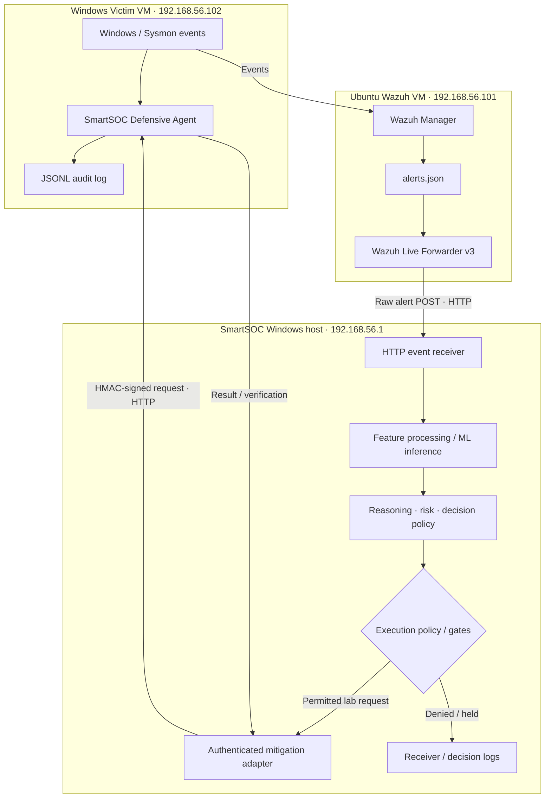

<div align="center">

# 🛡️ SmartSOC-AI

### AI-Assisted Security Operations & Controlled Endpoint Response

**A lab-focused SOC automation project connecting Wazuh telemetry, ML-assisted analysis, response policy, and an auditable Windows defensive agent.**

<p>
  <a href="https://github.com/Atharv1015/SmartSOC-AI"></a>
  
  
  
  
</p>

[Architecture](#-lab-architecture) · [Workflow](#-event-to-response-workflow) · [Components](#-core-components) · [Setup](#-getting-started) · [Safety](#-security-model--safety)

</div>

---

## 🔎 Project overview

**SmartSOC-AI** explores how a Security Operations Center workflow can combine endpoint telemetry, machine-learning-assisted event analysis, risk scoring, response decision logic, authorization boundaries, and controlled endpoint actions.

The lab is built around a simple principle: **a detection or model prediction is not, by itself, permission to take action**. Events should be interpreted in context, response policy should be evaluated, and endpoint actions should be restricted, authenticated, and auditable.

### Objectives

- Receive selected Windows endpoint alerts through Wazuh.
- Forward relevant raw alerts from the Ubuntu server to the SmartSOC host.
- Run the selected inference, reasoning, risk, and response-policy components.
- Keep endpoint execution behind separate policy and agent-side validation checks.
- Record decisions and endpoint outcomes for inspection and testing.
- Support repeatable defensive experiments in an isolated, authorized lab.

> [!IMPORTANT]
> **Status: research and development.** This repository contains multiple generations of receivers, policies, and adapters. Their presence does not prove that every path is connected or that a complete end-to-end scenario has passed. Review the integration notes before following the demo scripts.

## 🧭 Lab at a glance

The supplied code identifies **one SmartSOC Windows host and two lab VMs**. This is the topology documented by the available files, not a claim that the full environment contains no additional VMs or services.

| Node | Address shown in project files | Role | Main responsibilities |
|---|---|---|---|
| **SmartSOC controller host** | `192.168.56.1` | Windows host/workstation | Hosts the repository, Python receivers, inference and decision code, response adapter, launchers, tests, and operator consoles. The files do not establish that this node is itself a VM. |
| **Ubuntu Wazuh / forwarder VM** | `192.168.56.101` | Telemetry source and forwarder | Wazuh manager writes alerts to `/var/ossec/logs/alerts/alerts.json`; `wazuh_live_forwarder_v3.py` tails new entries and forwards selected raw alerts. |
| **Windows victim VM** | `192.168.56.102` | Monitored endpoint / defensive-agent host | Runs the Windows telemetry stack and the defensive-agent HTTP service; the agent validates requests, restricts target processes, records audits, and verifies process state after an action. |

The `192.168.56.x` addresses are hard-coded in the supplied scripts. They appear consistent with a private lab network, but the active virtual network mode and complete VM inventory must be confirmed on the host before running the system.

## 🏗️ Lab architecture



The diagram represents the intended system-level data flow assembled from the available code. It is not proof that the current launch scripts use a matching receiver/forwarder version or that every link has been validated in the live lab.

### Network endpoints found in source

| Link | Configured endpoint | Purpose |
|---|---|---|
| Ubuntu forwarder v3 → SmartSOC host | `http://192.168.56.1:8787/wazuh-event` | POST raw Wazuh alerts in an `{"event": ...}` envelope. |
| SmartSOC adapter/client → victim agent | `192.168.56.102:8765` | Send structured health or mitigation requests. |
| Defensive-agent listener | `0.0.0.0:8765` | Provides `GET /health` and `POST /mitigate`. The listener binds all interfaces on the victim; firewall/network isolation matters. |
| SmartSOC host → Ubuntu | SSH to `smartsoc@192.168.56.101` | Starts the forwarder through the checked-in launcher. |
| SmartSOC host → victim | SSH to `vboxuser@192.168.56.102` | The current audit watcher attempts to stream an agent audit file. |

**Transport security:** the supplied forwarder and defensive-agent client use HTTP, not TLS. HMAC authentication can authenticate a signed request and detect payload tampering, but it does not encrypt traffic. Restrict these endpoints to the isolated lab network; do not expose them directly to the Internet or an untrusted network.

## 🔁 Event-to-response workflow

### 1. Wazuh collection and forwarding — Ubuntu

The supplied `wazuh_live_forwarder_v3.py`:

- Tails `/var/ossec/logs/alerts/alerts.json` and begins at the current end of file; it does not replay historical alerts at startup.
- Filters alerts by Wazuh agent ID `001` **or** name `SmartSOC-Windows-Victim`.
- Forwards alerts whose rule IDs are in a configured allowlist.
- Keeps a bounded, in-memory set of recent alert IDs to skip duplicates.
- POSTs the original Wazuh alert and retries delivery up to three times.
- Writes UTC-timestamped activity to `~/smartsoc-forwarder-v3/logs/forwarder_v3.log`.

The forwarder transports telemetry. It does not execute endpoint commands, terminate processes, or contain hosts.

### 2. Analysis and response planning — SmartSOC host

The repository includes several layers, with the exact execution sequence dependent on which receiver/entry point is launched:

1. Event parsing and feature preparation.
2. Windows/APT-oriented ML inference.
3. Autonomous reasoning and risk assessment.
4. Decision policy and response planning.
5. Authorization/execution policy checks.
6. Mitigation adapter call, where the selected path and configuration permit it.

Multiple v1/v2 and candidate/historical modules coexist. Do not assume similarly named modules are interchangeable; validate the imports and runtime configuration for the intended entry point.

### 3. Defensive enforcement — Windows victim

The supplied defensive-agent file is versioned at `components/windows-defensive-agent/smartsoc_defensive_agent_v2.py`. The running VM may still use `C:\SmartSOC-Agent-v2\smartsoc_defensive_agent_v2.py`; the repository copy does not change that deployed path. The file describes a narrowly scoped endpoint service:

- Routes: `GET /health` and `POST /mitigate`.
- Supported action: `PROCESS_TERMINATION` only.
- Allowed process names: `notepad.exe` and `ping.exe`.
- Protected process names are explicitly denied.
- Client IP must be in the configured allowlist (`192.168.56.1`, loopback addresses).
- Requests require HMAC-SHA256 using the timestamp, nonce, and exact body in the signed message.
- Timestamp skew is limited to 120 seconds, and seen nonces are stored in memory to reject replays.
- Body length is capped at 16 KiB.
- The agent checks that the requested PID exists and its live process identity matches the request.
- It calls `taskkill` with an argument list and `shell=False`, then checks whether the process is still running.
- Results and relevant errors are written to a JSONL audit log.

A successful `/health` result is not evidence that a mitigation took place. The reported health state is separate from a verified action result.

### 4. Audit and evidence

The repository includes receiver diagnostics, a victim audit watcher, tests, and a separate manual evidence-collection bundle. The manual bundle is documented as separate from the live alert-to-response pipeline; do not describe it as automatic containment.

## 🧩 Core components

| Path | Responsibility |
|---|---|
| `src/production_inference_windows_apt_v4_1.py` | Windows/APT-oriented inference module |
| `src/inference/` and `src/inference_windows_apt_v4_1.py` | Inference implementations and related modules |
| `src/decision/` | Risk engine, decision policy, response planner, analyst-authorization logic |
| `src/risk/` | Risk-engine implementation |
| `src/integration/` | Receiver generations, Wazuh integration, approval and execution-policy components |
| `src/integration_v2/` | v2 execution configuration and authorization/dry-run bridges |
| `src/autonomous/` | Earlier autonomous reasoning and mitigation-controller code |
| `src/autonomous_v2/` | SmartSOC-side victim mitigation client and adapter |
| `components/ubuntu-forwarder/` | Versioned Ubuntu/Wazuh forwarder source and deployment notes |
| `components/windows-defensive-agent/` | Versioned Windows defensive-agent source and deployment notes |
| `docs/` | Lab architecture, repository map, and operational notes |
| `tests/` | Focused integration and unit tests |
| `test_*.py` | Additional inference and feature-forensics scripts |
| `tools/live_demo/` | Host-side receiver/forwarder launchers, audit watcher, and demo utilities |
| `manual_live_response_bundle/` | Separate manual evidence-collection helper |
| `containment/` | Evidence-staging documentation and placeholders |
| `data/integration/` | Selected integration event samples |
| `data/final/` | Dataset manifest metadata |

## 🗂️ Repository organization

The repository is organized into stable, purpose-specific areas:

- **`src/`** — SmartSOC inference, risk, decision, integration, and response-adapter code.
- **`components/ubuntu-forwarder/`** — the supplied Ubuntu Wazuh Forwarder v3 source and its deployment notes.
- **`components/windows-defensive-agent/`** — the supplied Windows defensive-agent source (filename v2; internal agent version v3) and its deployment notes.
- **`tests/`** — maintained component/integration tests. Root-level `test_*.py` files are retained for now because some legacy scripts may depend on project-root-relative paths.
- **`tools/`** — launchers, diagnostics, demo workflows, and utilities. Historical top-level patch scripts are intentionally left in place during this pass because several resolve project paths relative to their own location; moving them without refactoring and testing their path handling could break their behavior.
- **`data/`** — selected event samples and manifest metadata. Large datasets and model binaries are excluded by `.gitignore`.
- **`manual_live_response_bundle/` and `containment/`** — separate evidence-related tooling and documentation; these are not automatically part of the active alert pipeline.
- **`docs/`** — lab architecture and repository-organization notes.

The component files under `components/` are repository-managed copies of the files shared from the running lab. Deployment scripts on the VMs may still reference their existing local paths; copying a file into this repository does not deploy it to a VM or update its launch scripts.

## 📦 VM component packages and deployment guides

The actual source files shared from the lab are kept in separate, clearly named folders:

- [`components/ubuntu-forwarder/`](components/ubuntu-forwarder/README.md) — `wazuh_live_forwarder_v3.py`, which tails Wazuh alerts and forwards selected raw events.
- [`components/windows-defensive-agent/`](components/windows-defensive-agent/README.md) — `smartsoc_defensive_agent_v2.py`, whose embedded agent identifier is v3 HMAC.
- [`docs/DEPLOYMENT_GUIDE.md`](docs/DEPLOYMENT_GUIDE.md) — host/Ubuntu/victim deployment order and checks.

These are source-controlled copies. Publishing them does not remotely install, restart, or configure anything on the VMs. Follow each component guide and verify the endpoint addresses and safety gates locally.

## 🚦 Integration caveats to resolve

> [!WARNING]
> These are version/configuration mismatches visible in the supplied repository files. They are documented here, not automatically changed by this README.

### Receiver port and route mismatch

- The supplied Ubuntu **forwarder v3** sends to `http://192.168.56.1:8787/wazuh-event`.
- `src/integration/smartsoc_live_receiver_v2.py` is configured for port `8787`.
- `tools/live_demo/run_receiver.ps1` instead launches `src/integration/smartsoc_receiver_v1.py` and prints an endpoint on port `8788` with `LOG_ONLY` behavior.
- `tools/live_demo/Start-SmartSOC-LiveDemo.ps1` checks port `8788` before launching its tabs.

Before a live demonstration, explicitly choose the intended receiver generation and make the health check, route, port, and forwarding destination agree. The README does not assume which receiver you intend to standardize on.

### Defensive-agent audit path mismatch

- The supplied defensive-agent source declares internal agent version v3 and writes `logs/smartsoc_defensive_agent_v3_audit.jsonl` relative to the script directory.
- The checked-in `tools/live_demo/watch_victim_audit.ps1` attempts to stream `C:\SmartSOC-Agent-v2\logs\defensive_agent_v2_audit.jsonl`.

Confirm the actual installed agent version and update the watcher separately if needed; this documentation-only change does not modify either file.

### Additional operational limitations

- Forwarder duplicate suppression is in memory and resets when the forwarder restarts.
- Delivery retries are bounded; failed alerts are eventually abandoned and there is no durable retry queue in the supplied forwarder.
- Some host paths, usernames, addresses, ports, and policy values are hard-coded in scripts.
- Process termination is not network-level containment and cannot undo activity that happened before termination.
- Full end-to-end behavior and the complete test suite are not claimed as verified here.

## 🚀 Getting started

### Prerequisites

Requirements vary by component. The forwarder and supplied defensive agent mainly use Python standard-library modules; inference, evaluation, and test workflows may require third-party dependencies and model/data artifacts.

- Windows SmartSOC host with Python and PowerShell.
- Ubuntu VM with Wazuh writing `/var/ossec/logs/alerts/alerts.json`.
- Windows victim VM with the intended endpoint telemetry and defensive-agent configuration.
- Isolated lab networking and working SSH access to the configured nodes.
- Correctly provisioned secrets set via environment variables, never committed to Git.
- Dependencies required by the specific receiver/inference entry point.

### 1. Clone the repository

```powershell
git clone https://github.com/Atharv1015/SmartSOC-AI.git
Set-Location SmartSOC-AI
```

### 2. Create a host-side Python environment

```powershell
py -3 -m venv .venv
.\.venv\Scripts\Activate.ps1
python -m pip install --upgrade pip
```

A complete, tested root dependency manifest has not yet been established. Select a component first and check its imports and instructions before installing dependencies.

### 3. Verify the Ubuntu forwarder prerequisites

On Ubuntu, verify Python and readability of the Wazuh alert stream:

```bash
python3 --version
test -r /var/ossec/logs/alerts/alerts.json && echo "Wazuh alert file is readable"
```

The source is versioned at `components/ubuntu-forwarder/wazuh_live_forwarder_v3.py`. The current Windows launcher still expects a deployed copy under `~/smartsoc-forwarder-v3` and runs `python3 -u wazuh_live_forwarder_v3.py` there. Keep the VM deployment and repository copy in sync, or revise the launcher in a separate, tested change.

### 4. Configure the defensive agent safely

The agent expects a shared `SMARTSOC_AGENT_SECRET` of at least 32 characters and the `SMARTSOC_ALLOW_TERMINATION=1` environment gate for POST execution. Provision secrets separately on the intended endpoints; never paste them into source files, README content, Git history, screenshots, or chat.

Keep live termination disabled during installation and initial validation. Review the agent IP allowlist, target process allowlist, and effective SmartSOC execution policy before any action-enabled test.

### 5. Run relevant tests

After installing the required test dependencies, this is a starting point for the focused test directory:

```powershell
python -m pytest tests
```

This is a suggested command, not a statement that the tests currently pass. Record the actual command, environment, and pass/fail results when validating a clean installation.

## 🔐 Security model and safety

SmartSOC-AI is intended for authorized defensive testing in an isolated lab.

1. Verify VM identity, addresses, target agent ID, network mode, and receiver route before testing.
2. Start with read-only or dry-run workflows and confirm that the endpoint remains unchanged.
3. Inspect the exact policy imported by the selected receiver; do not infer runtime safety from a filename or README.
4. Preserve Windows endpoint protection; never add protected OS/security processes to the allowlist.
5. Test rejected signatures, stale timestamps, replayed nonces, unexpected clients, invalid PIDs, and mismatched process names.
6. Review audit records and sanitize logs before sharing them.
7. Keep the HTTP services bound to an isolated, access-controlled lab network.
8. Keep tokens, keys, shared secrets, raw private alerts, personal data, and sensitive operational details out of the public repository.

> [!CAUTION]
> The committed `src/integration_v2/execution_config_v2.py` currently sets `DRY_RUN = False` alongside controlled-lab execution flags. The supplied Windows agent also has a separate `SMARTSOC_ALLOW_TERMINATION` gate and shared-secret requirement. One checked-in receiver version also contains the literal placeholder `SMARTSOC-LAB-V1-CHANGE-ME`; do not treat that value as a valid shared secret. This README update does not change any settings or code. Review the effective configuration and provision secrets outside Git before any action-enabled test.

## ✅ Validation checklist

Use this as a record of work to complete; unchecked items are not claimed to be done.

- [ ] Confirm VM inventory, operating systems, addresses, and network mode.
- [ ] Confirm Wazuh agent identity and expected rule IDs.
- [ ] Pair the intended receiver version, route, and port with forwarder v3.
- [ ] Align the audit watcher with the installed defensive-agent version.
- [ ] Validate receiver health and event ingestion using benign test events.
- [ ] Verify invalid HMAC, stale timestamps, repeated nonces, and disallowed clients are rejected.
- [ ] Verify non-allowlisted and protected processes are rejected.
- [ ] Verify dry-run testing causes no endpoint change.
- [ ] Confirm audit records and sanitize any evidence for publication.
- [ ] Run the appropriate test set and record the real result.
- [ ] Review dataset/code licensing and the complete public-release diff.

## 🛣️ Roadmap

- [ ] Publish the complete VM inventory and verified network diagram.
- [ ] Select and document the supported receiver/forwarder version pairing.
- [ ] Align the victim audit watcher with the installed agent version.
- [ ] Add tested dependency manifests and per-component setup instructions.
- [ ] Capture reproducible test results and sanitized demo evidence.
- [ ] Review licenses for the code and datasets.
- [ ] Complete a repository-wide security and privacy review.

## 🤝 Contributing

Contributions should include a clear problem statement, reproduction steps, test output, and any security implications. Do not submit credentials, private alerts, customer data, proprietary datasets, or information about systems you are not authorized to test.

## 📄 License

No license is currently specified. Until a license is added, do not assume this project is licensed for reuse, modification, or redistribution.

---

<div align="center">

**SmartSOC-AI** · Defensive Security Engineering · Controlled Lab Research

</div>
