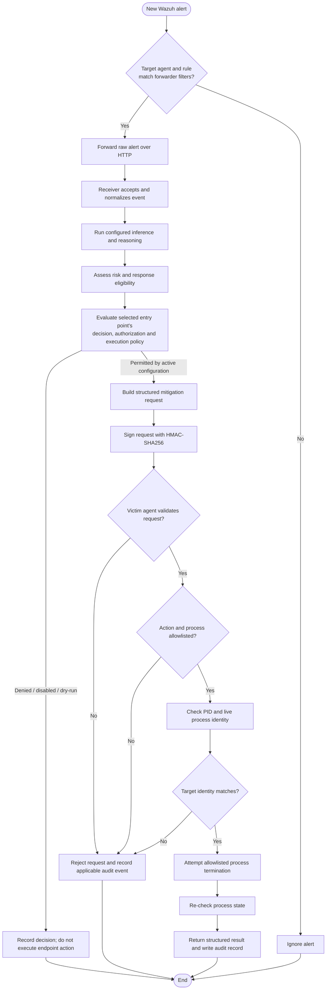

<div align="center">

# 🛡️ SmartSOC-AI

### AI-Assisted Security Operations · Wazuh Telemetry · Controlled Endpoint Response

**A research-and-development lab that explores how endpoint alerts can be analyzed, assessed, and routed through policy-controlled defensive workflows.**

<p>
  <a href="https://github.com/Atharv1015/SmartSOC-AI"></a>
  <a href="LICENSE"></a>
  
  
  
  
</p>

[Project overview](#project-overview) · [Lab topology](#lab-topology) · [Architecture](#architecture) · [Components](#component-responsibilities) · [Getting started](#getting-started) · [Safety](#security-model-and-safety)

</div>

---

## Project overview

**SmartSOC-AI** brings together a set of Python and PowerShell components for experimenting with a Security Operations Center workflow: Windows endpoint telemetry is collected by Wazuh, selected alerts are forwarded from an Ubuntu server, and the SmartSOC host runs the configured analysis and response-decision components. A separate Windows defensive agent exposes a narrow, authenticated interface for a limited endpoint action.

The core design principle is simple:

> **A security alert or model prediction is not, by itself, authorization to take action.**

SmartSOC separates event collection, model-assisted analysis, risk and decision logic, execution policy, endpoint-side validation, and audit evidence so each stage can be inspected and tested.

### What this project explores

- **Telemetry intake:** selecting relevant Wazuh alerts associated with the configured Windows agent.
- **Machine-learning-assisted analysis:** feature processing and Windows/APT-oriented inference modules.
- **Risk and response planning:** reasoning, risk assessment, decision policy, and response-planner components.
- **Controlled endpoint interface:** a narrow process-termination action with agent-side validation.
- **Authentication and audit:** HMAC-signed requests, time-window and nonce checks, target validation, outcome verification, and JSONL audit records in the supplied agent implementation.
- **Test and diagnostic tooling:** component-level tests, lab launch scripts, and inspection utilities.

> [!IMPORTANT]
> **Status: research and development.** The repository contains multiple generations of receiver, policy, inference, and adapter code. That code being present does not prove that every component is connected or that a full end-to-end run has passed. The active entry point and its configuration determine the behavior.

## Lab topology

The checked-in scripts and component files identify these **three lab roles**. Confirm them against your hypervisor and active network configuration; this table is a reference inventory from the code, not an assertion that the complete environment contains exactly three machines.

| Node | Address referenced by project files | Role | Main responsibilities |
|---|---|---|---|
| **SmartSOC controller host** | `192.168.56.1` | Windows host/workstation | Hosts the repository, receiver scripts, inference and decision modules, SmartSOC-side adapter/client, demos, tests, and diagnostics. The checked-in files do not establish that this node is itself a VM. |
| **Ubuntu / Wazuh VM** | `192.168.56.101` | Event collection and forwarding | Wazuh manager writes alerts to `/var/ossec/logs/alerts/alerts.json`; `wazuh_live_forwarder_v3.py` tails new entries and forwards selected raw alerts. |
| **Windows victim VM** | `192.168.56.102` | Monitored endpoint / defensive-agent host | Supplies endpoint telemetry and hosts the defensive-agent HTTP service, which validates constrained action requests and records outcomes. |

The `192.168.56.x` addresses and SSH usernames in scripts are environment-specific. They look consistent with a private lab segment, but **verify network isolation, VM names, addresses, and firewall rules before running services**.

## Architecture

The two diagrams below separate the system's **telemetry path** from the **decision and response path**. The first shows which machines and components communicate; the second walks through an individual alert and makes the decision branches explicit.

### 1. Deployment and communication map

```mermaid
flowchart LR
  subgraph VICTIM["Windows victim · 192.168.56.102"]
    direction TB
    SYS["Windows event sources<br/>Wazuh Agent / Sysmon, as configured"]
    AGENT["SmartSOC Defensive Agent<br/>HTTP :8765"]
    AUDIT["Agent audit log<br/>JSONL"]
    SYS -->|Endpoint events| WAZUH
    AGENT -->|Record request and result| AUDIT
  end

  subgraph UBUNTU["Ubuntu / Wazuh VM · 192.168.56.101"]
    direction TB
    WAZUH["Wazuh Manager"]
    ALERTS["alerts.json<br/>/var/ossec/logs/alerts/alerts.json"]
    FWD["Wazuh Live Forwarder v3<br/>rule filter · de-dup · bounded retry"]
    WAZUH --> ALERTS --> FWD
  end

  subgraph HOST["SmartSOC controller host · 192.168.56.1"]
    direction TB
    RX["HTTP event receiver<br/>route /wazuh-event"]
    ANALYZE["Event normalization and<br/>ML inference"]
    DECIDE["Reasoning · risk assessment ·<br/>decision policy / response planning"]
    GATE{"Configured execution gates"}
    RECORD["Decision / receiver logs"]
    CLIENT["SmartSOC mitigation<br/>adapter / client"]
    RX --> ANALYZE --> DECIDE --> GATE
    GATE -->|Denied, disabled or held| RECORD
    GATE -->|Request allowed by active path| CLIENT
  end

  FWD -->|Raw Wazuh alert<br/>HTTP POST · :8787| RX
  CLIENT -->|Structured request<br/>HMAC-SHA256 · HTTP :8765| AGENT
  AGENT -->|Status and verification result| CLIENT

  classDef telemetry fill:#EAF2FF,stroke:#3366CC,color:#132747,stroke-width:1.5px;
  classDef analysis fill:#F1EDFF,stroke:#7356C0,color:#24184A,stroke-width:1.5px;
  classDef control fill:#FFF4DF,stroke:#C68119,color:#543508,stroke-width:1.5px;
  classDef audit fill:#E7F7EF,stroke:#28865B,color:#123D2B,stroke-width:1.5px;
  class SYS,WAZUH,ALERTS,FWD,RX telemetry;
  class ANALYZE,DECIDE analysis;
  class GATE,CLIENT,AGENT control;
  class AUDIT,RECORD audit;
```



**How to read this diagram:**

1. Windows telemetry is collected by Wazuh on the Ubuntu side.
2. The forwarder reads new Wazuh alerts, filters them, and sends the selected raw alert to the SmartSOC receiver.
3. The configured receiver entry point invokes the analysis and decision components it supports.
4. A denied, disabled, or held action is recorded without sending an endpoint request. Only a path that passes its active gates can call the adapter.
5. The Windows defensive agent performs its own request and target validation, reports a result, and writes an audit record.

### 2. Inside one alert: decision and response sequence



This is a **conceptual workflow**, not a guarantee that all branches are enabled by default. The exact behavior depends on the active receiver version, execution policy, environment gates, and the deployed agent version.

## Component responsibilities

### Ubuntu Wazuh forwarder — `components/ubuntu-forwarder/`

The supplied `wazuh_live_forwarder_v3.py` is a telemetry transport component. It does not execute commands or perform mitigation.

- Reads `/var/ossec/logs/alerts/alerts.json` and starts at the current end of file; it does not replay earlier alerts on startup.
- Selects alerts whose agent ID is `001` **or** name is `SmartSOC-Windows-Victim`, and whose rule ID is in the configured allowlist.
- Suppresses duplicate alert IDs using an in-memory set/queue capped at 10,000 IDs.
- Sends the raw alert inside an `{"event": ...}` JSON envelope.
- Uses a 30-second HTTP timeout and up to three attempts for retryable delivery failures.
- Writes UTC-timestamped messages to `~/smartsoc-forwarder-v3/logs/forwarder_v3.log`.

See [Ubuntu forwarder setup and troubleshooting](components/ubuntu-forwarder/README.md).

### SmartSOC analysis and decision engine — `src/`

The repository contains several related modules rather than a single monolithic pipeline:

- `src/production_inference_windows_apt_v4_1.py` — Windows/APT-oriented inference module.
- `src/inference/` and `src/inference_windows_apt_v4_1.py` — inference implementations and related processing code.
- `src/decision/` — risk engine, decision policy, response planner, and analyst-authorization logic.
- `src/risk/` — risk engine implementation.
- `src/integration/` — Wazuh/receiver integration, approval and execution-policy components, and earlier receiver generations.
- `src/integration_v2/` — v2 policy and bridge components.
- `src/autonomous/` — earlier autonomous reasoning and mitigation-controller code.
- `src/autonomous_v2/` — SmartSOC-side victim mitigation client and adapter.

Because multiple generations coexist, check the exact file imported by the receiver you launch. The directory name alone does not indicate which code path is active.

### Windows defensive agent — `components/windows-defensive-agent/`

The supplied agent implementation offers `GET /health` and `POST /mitigate` on port `8765`. Its source declares the version `smartsoc-defensive-agent-v3-hmac`; the checked-in deployment filename has historically used `smartsoc_defensive_agent_v2.py`.

The supplied implementation documents these checks:

- The only supported action is `PROCESS_TERMINATION`.
- The process-name allowlist is `notepad.exe` and `ping.exe`, with explicit protected-process denials.
- The caller IP must match the agent's client allowlist.
- Requests carry HMAC-SHA256 over the timestamp, nonce, and exact request body.
- Timestamps outside a 120-second window and reused nonces are rejected.
- Request bodies are limited to 16 KiB.
- The agent checks that the PID is running and the live process name matches the requested target.
- The termination command is invoked without a shell, and process state is checked afterward.
- Request/action outcomes are written to a JSONL audit file.

These are source-level behaviors, not independently asserted test results. See [defensive-agent deployment and safety notes](components/windows-defensive-agent/README.md).

## Ports and integration compatibility

The following values are from the current checked-in files. Treat them as configuration to verify, not as proof of network reachability.

| Component | Endpoint | Notes |
|---|---|---|
| Ubuntu forwarder v3 → SmartSOC receiver | `http://192.168.56.1:8787/wazuh-event` | POSTs raw alert JSON in an `event` envelope. |
| SmartSOC-side client/adapter → victim | `192.168.56.102:8765` | Health and mitigation interface; mitigation POST has additional gates. |
| Victim defensive agent | `0.0.0.0:8765` | Binds all interfaces; restrict access with VM network isolation and Windows Firewall. |
| Demo `run_receiver.ps1` | Prints a `LOG_ONLY` endpoint at port `8788` | Starts `smartsoc_receiver_v1.py`, a different receiver generation. |
| `smartsoc_live_receiver_v2.py` | Configured on port `8787` | Matches the forwarder v3's port in source, but verify route and runtime policy. |
| Demo audit watcher | `C:\SmartSOC-Agent-v2\logs\defensive_agent_v2_audit.jsonl` | Does not match the supplied agent's `smartsoc_defensive_agent_v3_audit.jsonl` filename. |

> [!WARNING]
> **Two mismatches need a deliberate choice before a live demo.** The checked-in demo launcher targets the v1 receiver at `8788`, while forwarder v3 targets `/wazuh-event` at `8787`. The audit watcher also names a different agent audit file than the supplied agent source. This README does not change launchers, routes, or runtime configuration. See [lab architecture notes](docs/LAB_ARCHITECTURE.md) and the [deployment guide](docs/DEPLOYMENT_GUIDE.md).

## Getting started

### 1. Clone the repository

```powershell
git clone https://github.com/Atharv1015/SmartSOC-AI.git
Set-Location SmartSOC-AI
```

### 2. Prepare the Windows host environment

```powershell
py -3 -m venv .venv
.\.venv\Scripts\Activate.ps1
python -m pip install --upgrade pip
```

A complete, tested root-level dependency manifest is not currently documented. Choose the component first, inspect its imports, and install only the dependencies required by that workflow.

### 3. Check the Ubuntu alert source and forwarder

On the Ubuntu VM:

```bash
python3 --version
test -r /var/ossec/logs/alerts/alerts.json && echo "Wazuh alert file is readable"
python3 -m py_compile ~/smartsoc-forwarder-v3/wazuh_live_forwarder_v3.py
```

The launcher expects the script under `~/smartsoc-forwarder-v3/`. The repository copy lives under `components/ubuntu-forwarder/`; consult that component README for the intended copy path and startup steps.

### 4. Validate the defensive agent without enabling termination

On the Windows victim, start with the execution gate unset and validate the agent locally. For example, from an elevated or otherwise appropriately permissioned PowerShell session, use the component's documented location:

```powershell
py -3 -m py_compile C:\SmartSOC-Agent-v2\smartsoc_defensive_agent_v2.py
Invoke-RestMethod -Uri 'http://127.0.0.1:8765/health' | ConvertTo-Json -Depth 5
```

Do not configure the shared secret in source code or commit it to Git. The POST endpoint requires local environment gates and an HMAC secret; keep the execution gate off during installation and negative testing. Follow the component guide rather than enabling live actions as part of initial setup.

### 5. Run component tests

After installing the required test dependencies, the maintained tests can be invoked with:

```powershell
python -m pytest tests
```

This is a suggested command, not a claim that the tests currently pass. Record actual output and environment details when you test a clean setup.

## Security model and safety

SmartSOC-AI is intended for authorized defensive research in an isolated lab. Before any response-enabled experiment:

1. Confirm the target VM, network isolation, agent identity, receiver route, and port pairing.
2. Review the **effective configuration of the selected receiver** rather than inferring behavior from a filename or README.
3. Start with a non-destructive or dry-run path where supported and inspect the resulting logs.
4. Keep Windows Defender and other endpoint protections enabled. Do not add protected processes to allowlists.
5. Keep HMAC secrets, passwords, private keys, tokens, private alerts, and sensitive audit output outside the public repository.
6. Restrict HTTP endpoints to the lab network and configure host firewall rules. HMAC does not encrypt HTTP traffic.
7. Keep tests to systems and processes you own or are explicitly authorized to assess.

> [!CAUTION]
> The currently checked-in `src/integration_v2/execution_config_v2.py` has `DRY_RUN = False` and several controlled-lab execution flags enabled. The defensive agent adds separate `SMARTSOC_AGENT_SECRET` and `SMARTSOC_ALLOW_TERMINATION` gates, while receiver paths may have their own conditions. A receiver source also contains a placeholder token value. **This documentation change does not alter those runtime settings.** Review the actual code path and keep live execution disabled until the lab configuration has been explicitly reviewed and authorized.

## Known limitations

- Multiple generations of receivers and integration code remain in the repository.
- The forwarder uses in-memory deduplication; its duplicate cache resets on restart.
- The supplied forwarder retries a bounded number of times and then abandons failed delivery; it does not persist a retry queue.
- HTTP traffic is not encrypted.
- A process termination is not network-level containment and cannot undo earlier activity.
- The full alert-to-response path and full test suite are not claimed to have been independently verified by this README.
- Model quality depends on features, data, preprocessing parity, and evaluation methodology. No detection accuracy, latency, or production-readiness claim is made here.

## Repository map

| Path | Contents |
|---|---|
| `components/ubuntu-forwarder/` | Ubuntu/Wazuh forwarder v3 and deployment guide |
| `components/windows-defensive-agent/` | Defensive-agent source versions and deployment guide |
| `src/inference/`, `src/inference_windows_apt_v4_1.py` | Inference implementations |
| `src/decision/`, `src/risk/` | Risk, response planning and decision logic |
| `src/integration/`, `src/integration_v2/` | Receivers, event integration, policy/approval bridges |
| `src/autonomous/`, `src/autonomous_v2/` | Reasoning/controllers and mitigation adapter/client |
| `tests/` | Maintained integration and unit test collection |
| Root-level `test_*.py` | Additional forensic and inference tests retained for compatibility |
| `tools/live_demo/` | Launchers, audit watcher, and demonstration utilities |
| `docs/` | Lab architecture, repository structure and deployment guide |
| `data/integration/` | Selected integration-event samples |
| `data/final/` | Dataset manifest metadata |
| `manual_live_response_bundle/` | Separate manual evidence-collection helper; not automatically wired into the live pipeline |
| `containment/` | Evidence-staging documentation and placeholders |

Legacy patch and diagnostic scripts remain at the repository root intentionally. Moving them without reviewing path assumptions and retesting their entry points could break existing workflows.

## Validation checklist

- [ ] Confirm VM names, OS versions, IP addresses and network mode
- [ ] Confirm Wazuh agent ID/name and rule allowlist match the lab
- [ ] Select one receiver version and match the forwarder route/port to it
- [ ] Confirm event delivery in receiver logs before response testing
- [ ] Confirm invalid signatures, stale timestamps and replayed nonces are rejected
- [ ] Confirm non-allowlisted/protected targets are rejected
- [ ] Confirm the chosen dry-run path causes no endpoint change
- [ ] Run the relevant tests and record actual results
- [ ] Resolve the audit watcher/log filename mismatch
- [ ] Review source, alert samples, license compatibility and secrets before public sharing

## Roadmap

- [ ] Validate and document the final active receiver/forwarder pairing
- [ ] Confirm the complete VM and service inventory from the hypervisor
- [ ] Establish tested dependency manifests by component
- [ ] Document validated startup, shutdown, and troubleshooting commands
- [ ] Publish sanitized demo evidence and repeatable test results
- [ ] Review ownership and license compatibility for code and data assets

## License

This project is licensed under the [MIT License](LICENSE). This applies only to material you have the rights to license; it does not override third-party or dataset licenses.

---

<div align="center">

**SmartSOC-AI** · Defensive Security Engineering · Controlled Lab Research

<sub>Document what the code verifies. Keep response actions scoped, explicit, and auditable.</sub>

</div>
