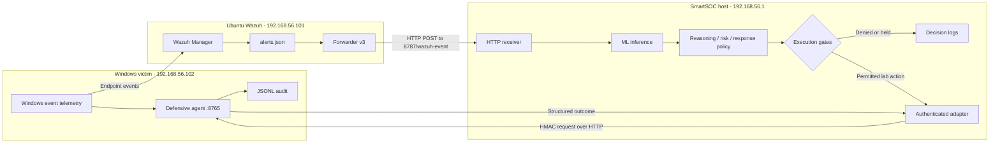

# SmartSOC-AI Lab Architecture

## Inventory supported by the shared code

The current scripts identify three lab roles. Treat this as a reference inventory until confirmed against the hypervisor:

| Role | Address | Evidence from code | Responsibility |
|---|---|---|---|
| SmartSOC host / controller | `192.168.56.1` | Receiver constants and demo launchers | Receives forwarded events, runs inference/decision logic and may call the defensive-agent adapter |
| Ubuntu Wazuh / forwarder VM | `192.168.56.101` | `tools/live_demo/run_ubuntu_forwarder.ps1` | Wazuh alert stream at `/var/ossec/logs/alerts/alerts.json`; forwarder v3 filters and forwards selected raw alerts |
| Windows victim VM | `192.168.56.102` | `tools/live_demo/watch_victim_audit.ps1` and agent/client source | Emits endpoint events and hosts the constrained defensive-agent endpoint on port `8765` |

The files do not establish if the SmartSOC host is itself a VM or if the lab contains other machines/services. Confirm OS versions, hypervisor network mode, VM names, and addresses manually.

## Data flow

## Port and audit mismatches

- The supplied forwarder v3 targets `http://192.168.56.1:8787/wazuh-event`.
- The checked-in `src/integration/smartsoc_live_receiver_v2.py` uses port `8787`.
- The checked-in `tools/live_demo/run_receiver.ps1` starts `smartsoc_receiver_v1.py` and prints a `LOG_ONLY` endpoint on port `8788`.
- The live-demo launcher health check also probes port `8788`.
- The supplied agent writes `logs/smartsoc_defensive_agent_v3_audit.jsonl`, relative to its script directory.
- The checked-in audit watcher tails `C:\SmartSOC-Agent-v2\logs\defensive_agent_v2_audit.jsonl`.

Choose and verify the intended receiver and victim-agent versions before running the complete workflow. This document only records mismatches; it does not change launcher/configuration behavior.

## Network security

The described forwarder and agent calls use HTTP. HMAC-SHA256 can authenticate request contents and protect their integrity; it does not encrypt traffic. Keep ports `8787`, `8788`, and `8765` within an isolated and access-controlled lab network. Verify Windows Firewall rules and VM network isolation.
